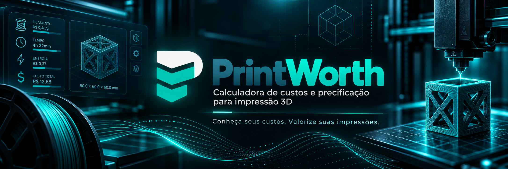
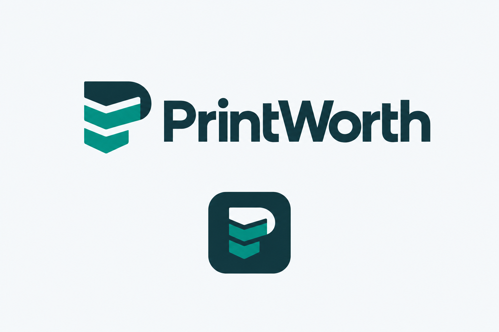
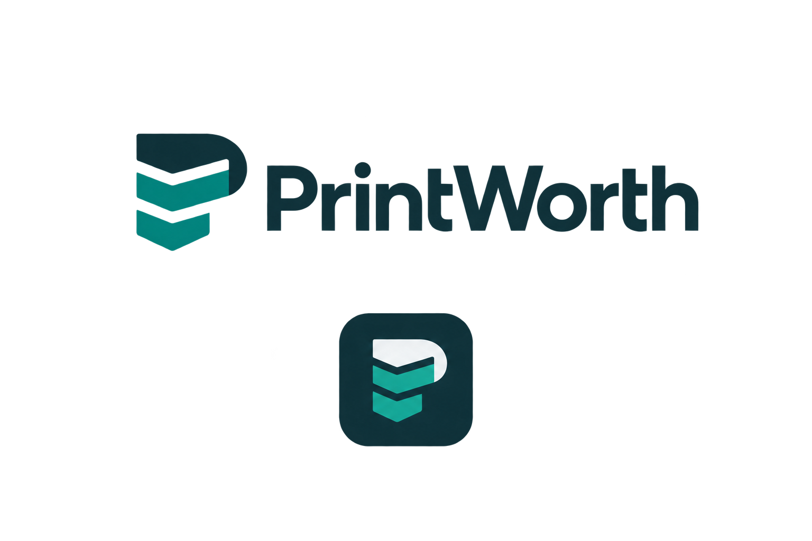
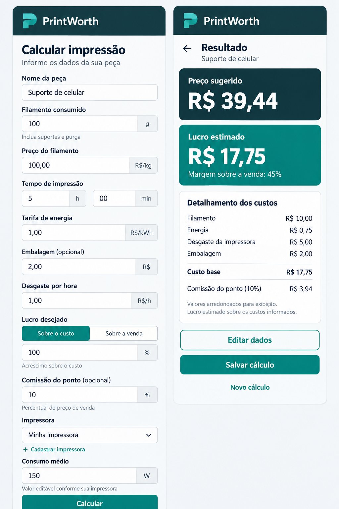
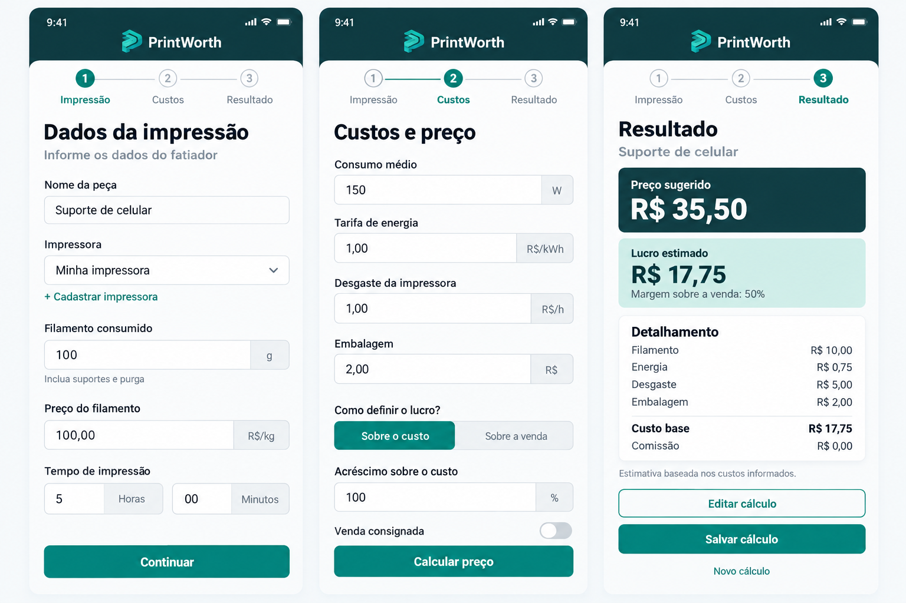

<div align="center">




**Conheça seus custos. Valorize suas impressões.**

</div>

---

## 📱 Sobre o projeto

O **PrintWorth** é um aplicativo Android desenvolvido em **Kotlin**, utilizando **Compose Multiplatform**, para auxiliar profissionais, empreendedores e entusiastas da impressão 3D.

A proposta é oferecer uma ferramenta simples, precisa e intuitiva para calcular custos de fabricação de peças e sugerir preços de venda, considerando despesas de produção e a margem de lucro desejada.

O aplicativo está sendo desenvolvido como parte do meu **portfólio profissional em desenvolvimento Android**, seguindo boas práticas de programação, arquitetura organizada e documentação contínua.

> **Status:** o projeto está em desenvolvimento. As funcionalidades descritas a seguir fazem parte do escopo planejado.

---

## ✨ Funcionalidades previstas

### 🧵 Custos de produção

- [ ] Cálculo do custo do filamento.
- [ ] Cálculo do consumo de energia elétrica.
- [ ] Cálculo do desgaste da impressora.
- [ ] Inclusão opcional de custo de embalagem.
- [ ] Cálculo do custo total da peça.

### 💰 Precificação

- [ ] Aplicação da margem de lucro desejada.
- [ ] Inclusão opcional de comissão do ponto de venda.
- [ ] Cálculo do preço de venda sugerido.
- [ ] Cálculo do lucro estimado.
- [ ] Detalhamento dos custos.

### 🖨️ Impressoras

- [ ] Seleção de impressoras cadastradas.
- [ ] Cadastro de impressoras personalizadas.
- [ ] Definição da potência média utilizada.
- [ ] Armazenamento local das impressoras cadastradas.

### 📲 Experiência de utilização

- [ ] Interface intuitiva com Material 3.
- [ ] Formulário organizado por categorias.
- [ ] Tela de resultados.
- [ ] Validação dos campos.
- [ ] Preservação dos dados ao editar o cálculo.
- [ ] Funcionamento offline.

---

## 🧮 Regras de cálculo

O PrintWorth utiliza fórmulas para estimar os custos envolvidos em uma impressão 3D.

### 1. Custo do filamento

```text
Custo = (Peso em gramas / 1000) × Preço por kg
```

### 2. Custo de energia

```text
Consumo (kWh) = (Potência média em W / 1000) × Tempo em horas

Custo de energia = Consumo (kWh) × Tarifa de energia
```

### 3. Desgaste da impressora

```text
Custo de desgaste = Tempo em horas × Desgaste por hora
```

### 4. Custo total de produção

```text
Custo base =
    Filamento
  + Energia
  + Desgaste
  + Embalagem
```

### 5. Preço de venda sugerido

```text
Preço de venda = Custo base / (1 - Margem - Comissão)
```

A margem e a comissão devem ser convertidas de porcentagens para frações decimais.

A soma da margem com a comissão deve ser inferior a 100%.

### 6. Lucro estimado

```text
Valor da comissão = Preço de venda × Comissão

Lucro estimado =
    Preço de venda
  - Custo base
  - Valor da comissão
```

> As regras incluem uma política específica de precisão monetária e arredondamento, descrita na documentação técnica do projeto.

---

## 📊 Exemplo de cálculo

Considere uma peça impressa com os seguintes dados:

| Parâmetro | Valor |
|---|---|
| Filamento utilizado | 100 g |
| Preço do filamento | R$ 100,00/kg |
| Tempo de impressão | 5 horas |
| Potência média | 150 W |
| Tarifa de energia | R$ 1,00/kWh |
| Desgaste | R$ 1,00/h |
| Embalagem | R$ 2,00 |
| Margem desejada | 20% |
| Comissão | 10% |

### Resultado esperado

| Descrição | Valor |
|---|---:|
| Filamento | R$ 10,00 |
| Energia | R$ 0,75 |
| Desgaste | R$ 5,00 |
| Embalagem | R$ 2,00 |
| **Custo base** | **R$ 17,75** |
| **Preço de venda** | **R$ 25,36** |
| Comissão | R$ 2,54 |
| **Lucro estimado** | **R$ 5,07** |

Os resultados são estimativas baseadas nos custos informados.

Tributos, mão de obra, frete e possíveis falhas de impressão não estão incluídos automaticamente nesta versão.

---

## 🎨 Identidade visual

O PrintWorth utiliza uma identidade moderna e tecnológica, com cores relacionadas à precisão, confiabilidade e inovação.

| Cor | Código | Aplicação |
|---|---|---|
| Azul-petróleo | `#12343B` | Cor principal |
| Turquesa | `#007F73` | Destaques e botões |
| Branco suave | `#F5F8FA` | Fundo da interface |

A experiência visual será desenvolvida com **Compose Multiplatform e Material 3**.

### Identidade da marca

<p align="center">
  
  &nbsp;&nbsp;
  
</p>

<p align="center">
  <em>Identidade visual oficial do PrintWorth.</em>
</p>

### Conceito visual

A identidade do aplicativo utiliza um símbolo estilizado em formato de **P**, composto por elementos geométricos em camadas.

O conceito está relacionado à fabricação aditiva, à precisão e ao valor das peças produzidas.

As versões do logotipo e do banner são armazenadas na pasta `assets/branding/`.

---

## 📸 Protótipos da interface

As imagens abaixo representam a proposta visual inicial do aplicativo.

> **Importante:** os protótipos são referências de design. Eles não representam funcionalidades já implementadas ou resultados gerados pela versão atual do aplicativo.

### 🖨️ Fluxo principal do aplicativo

O fluxo visual planejado contempla três etapas:

1. **Impressão:** informações da peça, impressora, filamento e tempo de fabricação.
2. **Custos:** despesas operacionais, margem de lucro e comissão.
3. **Resultado:** preço sugerido e detalhamento dos custos.

<p align="center">
  
</p>

### 📱 Formulário e tela de resultados

O formulário reunirá as informações necessárias para o cálculo.

A tela de resultados apresentará o preço de venda sugerido, lucro estimado e detalhamento dos custos.

<p align="center">
  
</p>

### 🎯 Objetivos da experiência visual

- Interface clara e intuitiva.
- Organização lógica das informações.
- Identidade visual consistente.
- Componentes acessíveis.
- Campos identificados com suas unidades.
- Destaque para preço sugerido e lucro estimado.
- Navegação simples entre formulário e resultado.

Os protótipos poderão ser refinados durante a implementação no Android Studio.

---

## 🛠️ Tecnologias

| Tecnologia | Finalidade |
|---|---|
| Kotlin | Linguagem principal |
| Kotlin Multiplatform | Compartilhamento de código |
| Compose Multiplatform | Interface declarativa |
| Material 3 | Componentes de interface |
| Gradle Kotlin DSL | Gerenciamento de build |
| Git | Versionamento |
| GitHub | Repositório e documentação |

### Arquitetura planejada

O projeto adota uma organização com separação de responsabilidades entre interface, gerenciamento de estado e regras de negócio.

Estão previstos:

- ViewModel.
- StateFlow.
- Kotlin Coroutines.
- Separação entre apresentação e domínio.
- Testes unitários.
- Persistência local para impressoras.

As implementações serão adicionadas progressivamente.

### Princípios de desenvolvimento

- Separação de responsabilidades.
- Componentização da interface.
- Código de fácil manutenção.
- Regras de negócio independentes da interface.
- Validação de entradas.
- Testabilidade.
- Documentação contínua.

---

## 📂 Estrutura do projeto

```text
PrintWorth/
│
├── androidApp/
│   └── Aplicação Android
│
├── shared/
│   └── Código compartilhável
│
├── docs/
│   ├── architecture.md
│   ├── calculation-rules.md
│   └── requirements.md
│
├── assets/
│   ├── branding/
│   │   ├── printworth-banner.png
│   │   ├── printworth-logo-light.png
│   │   └── printworth-logo-semfundo.png
│   │
│   └── screenshots/
│       ├── printworth-flow.png
│       └── printworth-form-result.png
│
├── gradle/
├── build.gradle.kts
├── settings.gradle.kts
└── README.md
```

### Organização arquitetural planejada

```text
com.dannyrodrygues.printworth
│
├── designsystem
│   ├── theme
│   └── components
│
├── domain
│   ├── model
│   └── usecase
│
└── presentation
    ├── calculator
    └── result
```

O arquivo `App.kt` será responsável por conectar o fluxo principal da aplicação e aplicar o tema visual.

As fórmulas de cálculo permanecerão na camada de domínio.

---

## 🚀 Como executar

### Pré-requisitos

- Android Studio.
- Android SDK configurado.
- JDK compatível com o projeto.
- Dispositivo Android ou emulador.

### Clonar o projeto

```bash
git clone https://github.com/DannyRodrygues/PrintWorth.git
```

Entre no diretório:

```bash
cd PrintWorth
```

Abra o projeto no Android Studio e aguarde a sincronização do Gradle.

### Compilar o aplicativo

No terminal:

```bash
./gradlew :androidApp:assembleDebug
```

### Executar testes Android

```bash
./gradlew :shared:testAndroidHostTest
```

> A implementação da calculadora e seus testes específicos ainda estão em desenvolvimento.

---

## 📚 Documentação técnica

O PrintWorth possui documentação dedicada para manter a organização do desenvolvimento.

| Documento | Conteúdo |
|---|---|
| [Requisitos](docs/requirements.md) | Escopo, funcionalidades e critérios de aceitação |
| [Arquitetura](docs/architecture.md) | Estrutura de módulos, camadas e responsabilidades |
| [Regras de cálculo](docs/calculation-rules.md) | Fórmulas, precisão monetária e cenários de teste |

A documentação será atualizada continuamente conforme as funcionalidades forem desenvolvidas.

---

## 📌 Roadmap do desenvolvimento

### ✅ Etapa 1 — Planejamento e estrutura

- [x] Criação do projeto Android.
- [x] Estrutura inicial Kotlin Multiplatform.
- [x] Configuração do Git.
- [x] Publicação no GitHub.
- [x] Documentação inicial de requisitos.
- [x] Documentação da arquitetura.
- [x] Especificação das regras de cálculo.
- [x] Definição da identidade visual.
- [x] Criação dos protótipos iniciais.


### 🚧 Etapa 2 — Desenvolvimento

**Interface inicial e identidade visual**

- [x] Implementação da tela inicial em Compose.
- [x] Integração do logotipo oficial.
- [x] Aplicação da identidade visual PrintWorth.
- [x] Implementação do tema Light.
- [x] Implementação do tema Dark.
- [x] Alternância automática conforme o tema do Android.
- [x] Testes manuais no Xiaomi Redmi Note 9S.

**Calculadora e regras de negócio**

- [ ] Integração do botão "Iniciar cálculo" ao formulário.
- [ ] Implementação dos modelos de domínio.
- [ ] Implementação das regras de cálculo.
- [ ] Desenvolvimento do formulário.
- [ ] Desenvolvimento da tela de resultados.
- [ ] Cadastro de impressoras.
- [ ] Persistência local.


### 🧪 Etapa 3 — Qualidade

- [ ] Testes unitários.
- [ ] Validação das fórmulas.
- [ ] Tratamento de entradas inválidas.
- [ ] Testes em dispositivo Android.
- [ ] Revisão de acessibilidade.
- [ ] Verificação de desempenho.
- [ ] Revisão da interface.

### 📦 Etapa 4 — Distribuição

- [ ] Preparação da versão inicial.
- [ ] Assinatura do APK.
- [ ] Documentação de instalação.
- [ ] Disponibilização do APK.

---

## 👩‍💻 Desenvolvedora

**Dany Rodrigues**

Desenvolvimento Android com Kotlin e Compose Multiplatform.

GitHub: [@DannyRodrygues](https://github.com/DannyRodrygues)

Projeto desenvolvido para aprendizado, evolução profissional e composição de portfólio.

---

<div align="center">

### 🖨️ PrintWorth

**Conheça seus custos. Valorize suas impressões.**

Desenvolvido com Kotlin 💚

</div>
